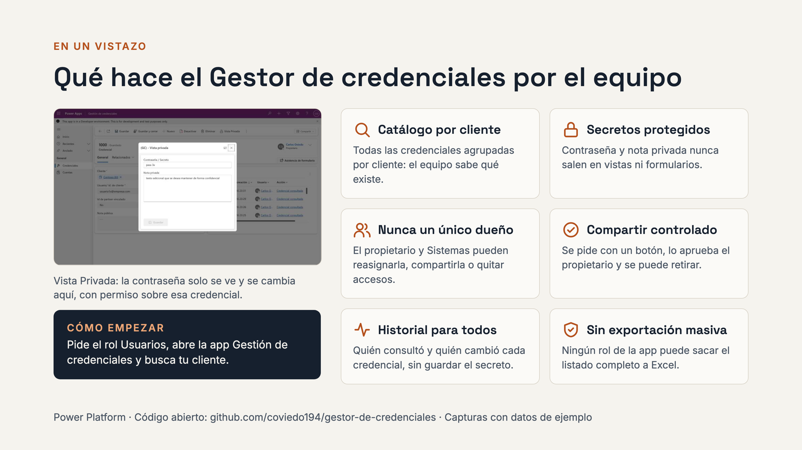
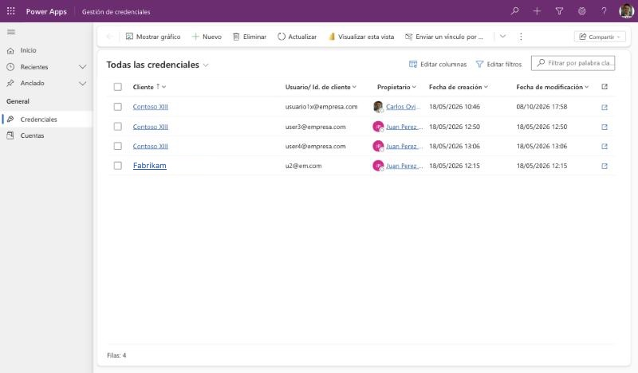
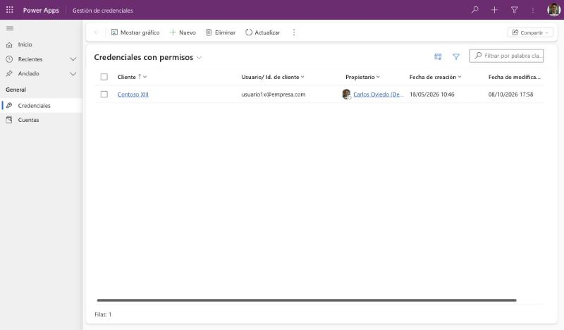
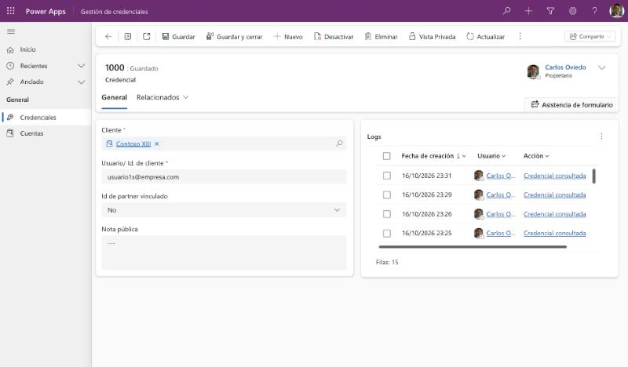
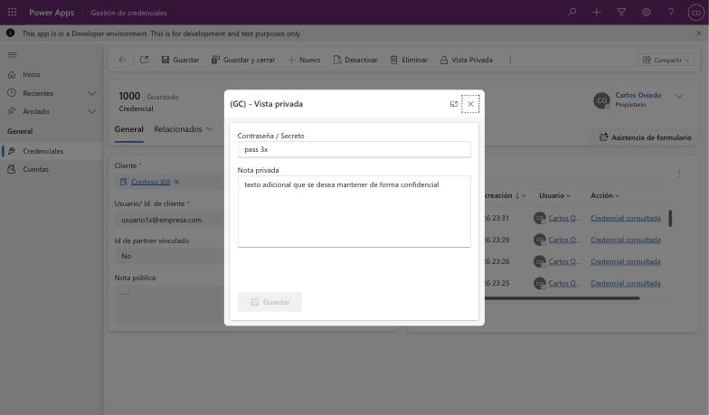
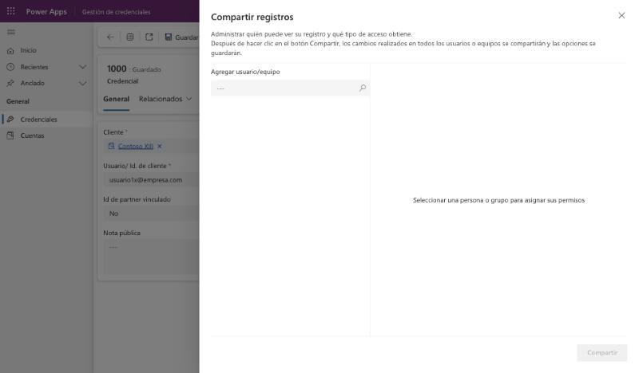

# Gestor de credenciales

**Gestor de credenciales** es una solución de Power Platform para tener un **catálogo de credenciales por cliente** sin exponer las contraseñas. Cualquiera del equipo ve qué credenciales existen y para qué cliente; la contraseña y la nota privada solo se ven si tienes permiso sobre ese registro, y si no lo tienes puedes **solicitarlo al propietario** con una aprobación.

Técnicamente es una **app basada en modelo** de Dataverse con una **custom page** (vista privada) y flujos de Power Automate.



## 📸 Capturas

> Capturas de un entorno de desarrollo con datos de ejemplo.

| Catálogo por cliente | Credenciales con permisos |
|---|---|
|  |  |
| Todo el equipo ve qué credenciales existen, sin contraseñas. | Las credenciales sobre las que tienes permiso. |

| Formulario e historial | Vista privada |
|---|---|
|  |  |
| Datos públicos, propietario y quién la consultó o actualizó. | La contraseña y la nota privada solo se ven aquí, con permiso sobre el registro. |

| Compartir |
|---|
|  |
| El propietario o un administrador de sistemas ve con quién está compartida y retira el acceso. |

## ✨ ¿Qué puedes hacer?

### Para todo el equipo (rol `Gestión de credenciales - Usuarios`)

- 📇 **Consultar el catálogo**: credenciales por cliente (cuenta) con usuario, partner y nota pública, sin contraseña.
- 🔐 **Abrir la vista privada**: desde una credencial, ver y actualizar contraseña y nota privada si tienes permiso de edición sobre ese registro.
- 🙋 **Solicitar acceso**: si no tienes permiso, la vista privada envía una aprobación al propietario; al aprobarla, la credencial se comparte contigo con lectura y escritura.
- 🕵️ **Ver el historial**: cada credencial muestra quién la consultó o actualizó, sin guardar nunca los valores secretos.

### Para quien gestiona el catálogo (rol `Gestión de credenciales - Admin`)

- ➕ **Dar de alta credenciales** y mantener las propias.
- 🤝 **Compartir y eliminar** sus credenciales.
- 🏢 **Crear y editar cuentas** (clientes).

Admin **no** es un superusuario de secretos: tampoco lee contraseñas directamente, solo a través de la vista privada y con permiso sobre el registro. El detalle de permisos está en [docs/alcance.md](./docs/alcance.md#matriz-actual-por-tabla-y-rol).

### Automatizaciones (Power Automate)

- 🔎 `(GC) Obtiene credenciales`: lee contraseña y nota privada para la vista privada y registra la consulta.
- ✏️ `(GC) Actualiza credenciales`: guarda los cambios y registra la actualización.
- ✅ `(GC) Solicitar permiso`: lanza la aprobación al propietario y comparte la credencial si se aprueba.

Cada uno es un flujo padre (llamado desde la app) que delega en un flujo hijo con la conexión de Dataverse.

## ⚠️ Antes de usarlo en producción

Hoy la vista privada comprueba el permiso **en la app**, pero los flujos confían en el usuario que la app les indica y no lo vuelven a comprobar. Alguien con conocimientos técnicos podría llamar a los flujos directamente. Úsalo en entornos de prueba o con datos no críticos hasta que esté implementada la autorización en los flujos; ver [mejoras pendientes](./docs/alcance.md#6-limitaciones-y-mejoras-pendientes).

## 🚀 Cómo empezar

### 👤 Quiero instalarlo en mi entorno

👉 Ve a [`solution/`](./solution/) y sigue su README: importar la solución, conectar las referencias de conexión, asignar los roles y configurar la variable de entorno.

> 📦 Descarga el `.zip` de la solución desde [Releases](../../releases).

### 👩‍💻 Quiero entender o mejorar la solución

- [docs/alcance.md](./docs/alcance.md): especificación funcional y técnica, matriz de roles, limitaciones y mejoras.
- [`solution/canvas-src/`](./solution/canvas-src/): fuentes legibles (YAML) de la vista privada.
- [`solution/package/`](./solution/package/): solución desempaquetada; se regenera con el script, no se edita a mano.

## 🤝 Cómo colaborar

- 🐞 **Reportar un bug o proponer una idea** abriendo un [issue](../../issues).
- 🔧 **Enviar mejoras** con un Pull Request desde un fork, describiendo el cambio.

> Los cambios en tablas, flujos, roles o la custom page se hacen en el entorno y después se regenera `solution/` con el script; esa carpeta **no se edita a mano**.

## 🗺️ Mapa rápido del repositorio

```
.
├── README.md                 ← este archivo
├── AGENTS.md                 ← instrucciones para agentes de IA
├── .env.example              ← plantilla de configuración local (perfil PAC)
├── docs/
│   ├── alcance.md            ← especificación funcional y técnica
│   └── capturas/             ← capturas e infografía con datos de ejemplo
├── .github/workflows/
│   └── release-solution.yml  ← publica la release con el .zip
└── solution/                 ← 👤 instalación
    ├── README.md                "Cómo instalar"
    ├── package/                 solución desempaquetada (solo lectura, se regenera)
    ├── canvas-src/              fuentes de la custom page (solo lectura, se regenera)
    └── scripts/                 regenerate-solution.ps1
```

## 🔮 Próximos pasos

- Autorización en los flujos (comprobar en el servidor quién llama y si tiene permiso).
- Expiración y revocación de accesos concedidos.
- Propuesta de versión 2 con Power Apps Code Apps.

Detalle en [docs/alcance.md](./docs/alcance.md).

## Licencia

Gestor de credenciales se distribuye bajo la [licencia MIT](./LICENSE).
Copyright (c) 2026 Carlos Oviedo Gibbons.

Las dependencias y los componentes de terceros conservan sus propias licencias.
